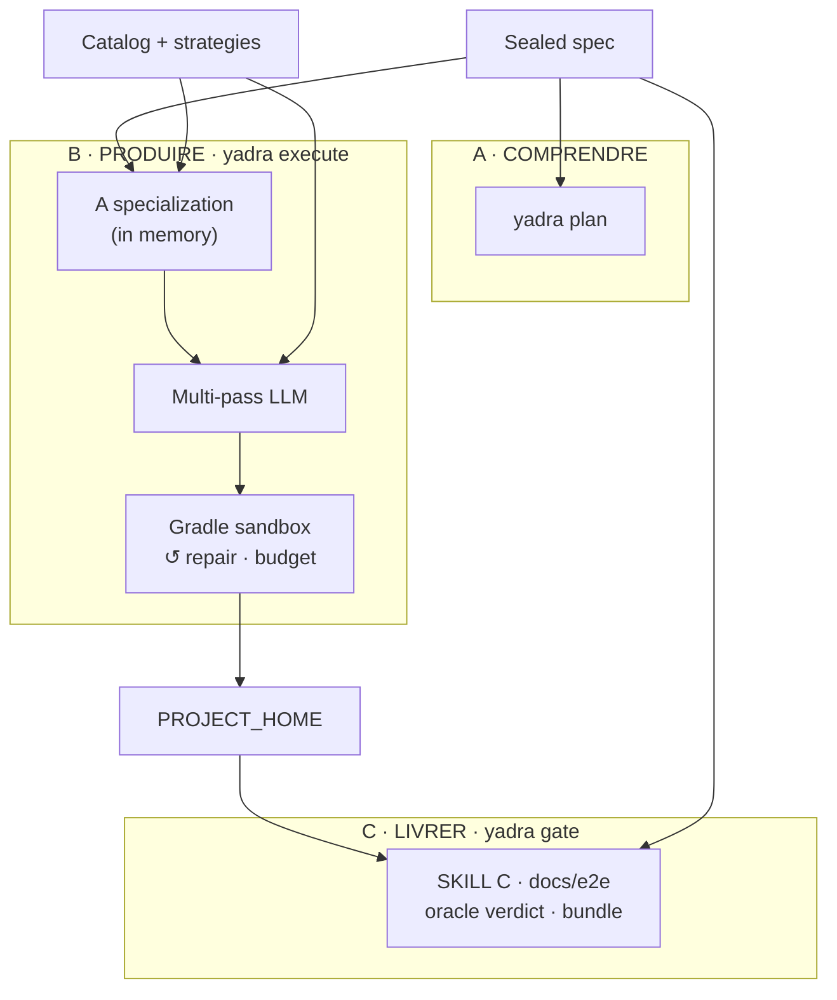

**Yadra** is a **Spec-to-Code Binder**: code exists only as a projection of the sealed KSL spec.

Two **Timelines**, one product trilogy:

**A · COMPRENDRE (Understand) → B · PRODUIRE (Produce) → C · LIVRER (Deliver)**

| Letter | Meaning |
|--------|---------|
| **COMPRENDRE** | Read context and contract; plan, resolution, specialization. |
| **PRODUIRE** | Materialize artifacts (KSL in T1, code in T2); **in T2 the quality loop lives here** (sandbox + repair). |
| **LIVRER** | Evidence, bundle, T1 seal or T2 Gate — **SKILL C**; CLI oracles for validate/seal/verdict; **optional IA** (`gate --produce`). |

Bridge between timelines: **sealed KSL contract** (`.yadra/sealed/` under `KSL_PROJECT_HOME`).

**Packaged CLI**: 0.1.2+ `plan` · 0.1.3+ `strategies` · **0.1.7+ `execute`** · **0.1.8+ `gate`** (T2 C · LIVRER).

## Historical diagrams (v0.1.0)

**0.1.0** HTML still labels « C · EXÉCUTER » and old « 100% sans IA · hermétique » on **C · LIVRER**; the **0.1.8 evolution** callout and this page supersede those badges.

| Diagram | Link |
|---------|------|
| Integrated architecture | [0.1.0-ksl-yadra-integrated-architecture.html](/architecture/0.1.0-ksl-yadra-integrated-architecture.html) |
| KSL families | [0.1.0-yadra-core-ksl-families.html](/architecture/0.1.0-yadra-core-ksl-families.html) |

## Timeline 1 — Formalization

**`yadra formalize`** runs A → B → C when KSL is missing; otherwise **C · LIVRER** only (validate + seal).

| Phase | Role | Where |
|-------|------|--------|
| **A · COMPRENDRE** | Intent → temporary `.compact.ksl` | SKILL `formalize/partie-a-comprendre` |
| **B · PRODUIRE** | `.ksl` at `output_paths` | SKILL `formalize/partie-b-produire` |
| **C · LIVRER** | SKILL C orchestration + **oracles** `validate` / digest **seal** | `yadra validate` / `yadra seal` (no mandatory LLM call in CLI) |

Plans: `yadra-t1-comprendre-intention`, `yadra-t1-produire-ksl`, `yadra-t1-livrer-ksl`.

## Timeline 2 — Materialization (0.1.7)

Same trilogy; **the iterative loop is inside B · PRODUIRE**, not C.

### KSL: `outputs` and `outputs.phase`

```ksl
outputs {
  kinds = ["ksl", "code", "data", "tests", "docs", "e2e"]
  phase {
    execute = ["code", "data", "tests"]   // CLI routing → B · PRODUCE
    gate    = ["docs", "e2e"]             // CLI routing → C · DELIVER
  }
  …
}
```

| `outputs.phase` (CLI) | Yadra phase | Command |
|------------------------|-------------|---------|
| **`execute`** | **B · PRODUIRE** (codebase kinds) | **`yadra execute`** — in-memory A + LLM + **Gradle sandbox + repair** (`budget`) |
| **`gate`** | **C · LIVRER** (surface kinds) | **`yadra gate`** — `--produce` (optional IA) + **Conformance Gate oracle**, bundle |
| — | **A · COMPRENDRE** | **`yadra plan`** (preview); A also **embedded** at start of `execute` |

Paths for `code` / `tests` / `data`: `project.repo`, stack, `data { }`, skeletons — not in `outputs`.  
`docs` / `e2e`: dedicated blocks → **LIVRER** via Gate.

### Stack and `PROJECT_HOME` (T2)

| KSL source | Role |
|------------|------|
| **`root.project.ksl`** (`kind = "root"`) | **`stack { build runtime framework … }`** — normative language and tooling for generation. |
| Service **`*.project.ksl`** | `repo.path`, stack merge near the spec (`t2-bindings`). |
| **`yadra project --project-home`** | **Target root** where **B · PRODUCE** writes (`execute`) — typically the repo at `repo.path`, not a separate pre-built app you must bring. |

**`yadra execute`** materializes code/tests/data from **stack + strategy skeletons** (e.g. Kotlin when `runtime = "kotlin"`). MVP sandbox runs **`gradle test`** when `stack.build = "gradle"`. Use `--no-verify` to produce without sandbox.

Refs: [outputs](/docs/en/ksl/reference/outputs/) · **`yadra-t2-produire-artefacts`** v5 · **`yadra-t2-comprendre-contrat`** v5.

### T2 diagram



**Key point:** `yadra execute` is **all of T2 B · PRODUCE** (not “write files only”). **`yadra gate`** is **C · LIVRER** only (`phase.gate`).

### Recommended flow

```bash
yadra make prompts/my-feature/                    # daily (T1 + T2)

# Expert:
yadra seal feature.spec.ksl
yadra plan feature.spec.ksl --skip-llm          # A · COMPRENDRE (preview)
yadra execute feature.spec.ksl                    # B · PRODUIRE (+ loop)
yadra gate feature.spec.ksl                       # C · LIVRER
```

| Variable | T2 use |
|----------|--------|
| `PROJECT_HOME` | **B · PRODUIRE** output |
| `budget.max_repair_loops` | Loop **inside B** (`execute`) |
| `.yadra/bundles/` | **C · LIVRER** (manifest + Gate verdict), not `execute` |

## LIVRER vs oracles (0.1.8+)

**Phase C · LIVRER** is **not** “100% without IA · hermetic” (T1 or T2): it uses **SKILL + plan**, and T2 may call the LLM via **`yadra gate --produce`**.

What stays **deterministic and decoupled from the producer LLM** (B or `--produce`):

| Oracle | Role |
|--------|------|
| `yadra validate` | L0–L3 on KSL |
| `yadra seal` | SHA-256 digests → `.yadra/sealed/` |
| **Conformance Gate** verdict | `SATISFIED` \| `VIOLATED` \| `UNDECIDABLE` on contract × evidence |

Legacy v0.1.0 diagram badges on **C · LIVRER** are **obsolete**; the HTML **0.1.8** callout and this section are canonical.

## Glossary vs legacy labels

| Legacy | Current |
|--------|---------|
| C · EXÉCUTER (T1) | **C · LIVRER** (seal KSL) |
| Monolithic T2 C / Gate | **B** = execute + loop; **C · LIVRER** = Gate |
| “T2 · B only” | **B · PRODUIRE** = full `yadra execute` |

Command detail: [`execute`](/docs/en/execute/).
