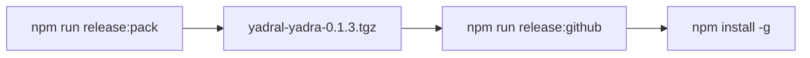

This guide describes the **end-to-end process** for distributing the Yadra CLI as a **`.tgz`** file (option 2: no public npm registry).

## Overview



The file is **not committed to git** (`yadra/cli/.gitignore` ignores `yadral-yadra-*.tgz` and `vendor/`). It is published as a GitHub **release asset**.

---

## 1. Build the package (maintainer)

From the monorepo:

```bash
cd yadra/cli
npm run release:pack
```

(`release:pack` runs `npm test`, `verify:vendor`, then `npm pack` / `pack:release`)

Output: **`yadral-yadra-0.1.3.tgz`** next to `package.json`.

| npm step | Action |
|----------|--------|
| **`prepack`** | `YADRA_VENDOR_STRICT=1 node scripts/sync-vendor.mjs` — copies the minimal distribution into `vendor/yadral-dist/` |
| **`npm pack`** | Archives `src/`, `vendor/`, `scripts/`, `package.json`, `README.md` |

### Files copied into `vendor/yadral-dist/`

| Source (monorepo) | Purpose |
|-------------------|---------|
| `yadra/manifest.mf` | Official CLI version |
| `yadra/skills/` | formalize SKILLS (T1) + execute (T2 · A) |
| `ksl/grammar/` | `ksl.ebnf` grammar |
| `ksl/tools/yadra/lib/` | validate / seal / plan engine |
| `prompts/plan-validate/` | Validated T1/T2 phase plans (yadra-t1, yadra-t2) |

Not included: documentation site, full KSL examples, rest of the repository.

### Local checks

```bash
npm run pack:dry-run          # list contents without writing .tgz
npm run verify:vendor         # strict sync + path checks
tar -tzf yadral-yadra-0.1.3.tgz | head
npm test                      # CLI tests + vendor presence
```

### Versioning

Before each release, align:

- `yadra/cli/package.json` → `"version"`
- `yadra/manifest.mf` → `version`

The filename becomes `yadral-yadra-<version>.tgz`.

---

## 2. Publish on GitHub (maintainer)

Do **not** `git add` the `.tgz`. Use a **GitHub Release**.

### Web UI

1. Open the repository → **Releases** → **Draft a new release**
2. **Choose a tag**: e.g. `yadra-cli-v0.1.3` (create the tag on `main` or the desired commit)
3. **Release title**: e.g. `Yadra CLI 0.1.3`
4. **Attach binaries**: upload `yadra/cli/yadral-yadra-0.1.3.tgz`
5. **Publish release**

### Prerequisites: GitHub CLI (`gh`)

`npm run release:github` invokes `gh release create`. Install [GitHub CLI](https://cli.github.com/) once per machine, then authenticate.

**macOS** (Homebrew):

```bash
brew install gh
gh auth login
```

**Linux — Debian / Ubuntu**:

```bash
sudo apt update
sudo apt install gh
gh auth login
```

**Linux — Fedora / RHEL (dnf)**:

```bash
sudo dnf install gh
gh auth login
```

Other distros or tarballs: [official Linux install guide](https://github.com/cli/cli/blob/trunk/docs/install_linux.md).

Verify: `gh --version` and `gh auth status`.

### Command line (npm)

Repository: [github.com/yadral/yadra](https://github.com/yadral/yadra)

```bash
git push origin main
cd yadra/cli
npm run release:pack
npm run release:github -- yadra-cli-v0.1.3
```

With no argument after `--`, the default tag is `yadra-cli-v` plus the version from `package.json` (e.g. `yadra-cli-v0.1.3` when `"version": "0.1.3"`).

The `release:github` script uploads `yadral-yadra-<version>.tgz`, sets the title **Yadra CLI &lt;version&gt;**, and install notes (see **Prerequisites: GitHub CLI** above — do not run `gh release create` by hand).

---

## 3. Download and install (developer)

Prerequisites: **Node.js ≥ 18**.

### From the Releases page

1. **Releases** → pick the version (e.g. `0.1.3`)
2. Download **`yadral-yadra-0.1.3.tgz`**
3. Install:

```bash
npm install -g ./yadral-yadra-0.1.3.tgz
yadra version
```

On first run, **`YADRA_PROJECT_HOME`** and **`KSL_HOME`** are set from the bundled distribution. **`--yadra-project-home`** is not required for normal use.

Anchor the KSL monorepo:

```bash
yadra configure set --profile default --provider … --model …
yadra configure credentials --profile default --token …
yadra project add myapp --ksl-project-home /path/to/your-ksl-monorepo
```

### Direct URL (stable per tag)

Replace `<org>`, `<repo>`, and tag name:

```text
https://github.com/yadral/yadra/releases/download/yadra-cli-v0.1.3/yadral-yadra-0.1.3.tgz
```

```bash
curl -L -o yadral-yadra-0.1.3.tgz \
  "https://github.com/yadral/yadra/releases/download/yadra-cli-v0.1.3/yadral-yadra-0.1.3.tgz"
npm install -g ./yadral-yadra-0.1.3.tgz
```

**Private** repository: GitHub authentication (browser session or token with repo access).

---

## 4. After install

| Action | Command |
|--------|---------|
| Verify toolchain | `yadra version` |
| KSL context | `yadra project add myapp --ksl-project-home …` |
| Timeline 1 | `yadra formalize …`, `yadra validate …`, `yadra seal …` |
| Timeline 2 | `yadra plan …` |

Upgrade: download the new release `.tgz`, then:

```bash
npm install -g ./yadral-yadra-<new-version>.tgz
```

---

## Next step (option 1)

The same `.tgz` build can later be published to a **private npm registry** (`npm publish`) without changing the build flow (`prepack` + `sync-vendor`). See the installation section on the [overview](/docs/en/overview/).
