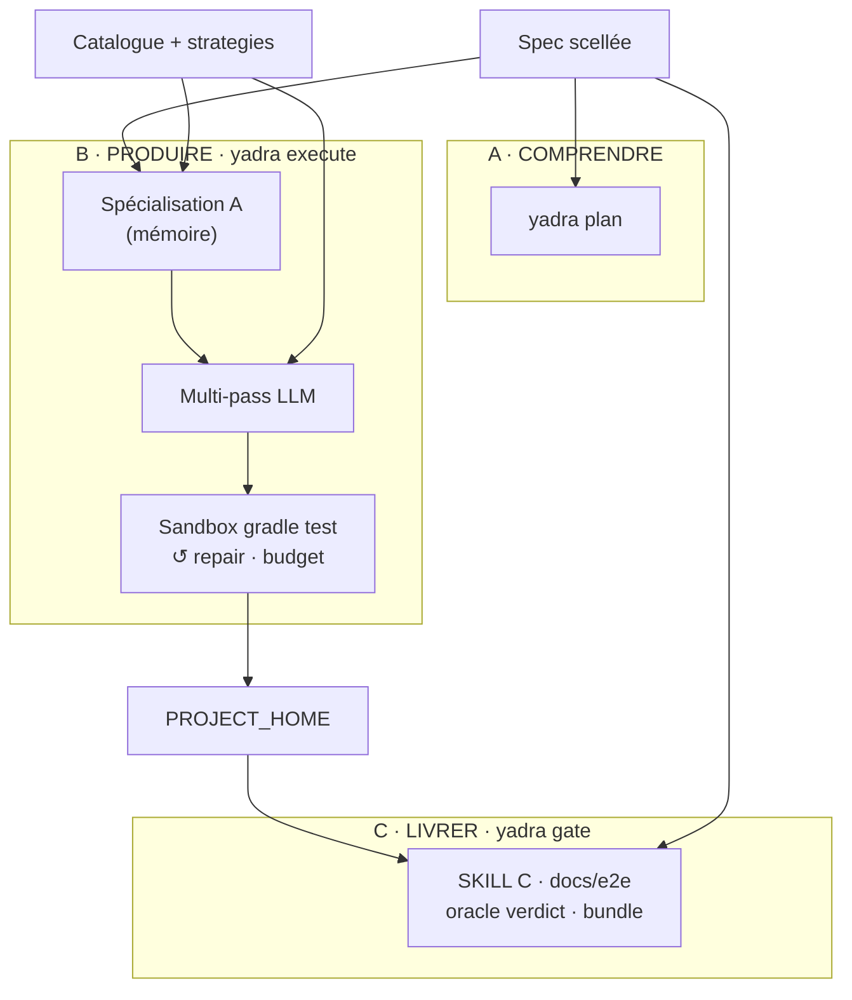

**Yadra** est un **Spec-to-Code Binder** : le code n’existe que comme projection liée à la spec KSL scellée.

Deux **Timelines** étanches, même triade produit :

**A · COMPRENDRE → B · PRODUIRE → C · LIVRER**

| Lettre | Sens |
|--------|------|
| **COMPRENDRE** | Lire le contexte et le contrat ; plan, résolution, spécialisation. |
| **PRODUIRE** | Matérialiser les artefacts (KSL en T1, code en T2) ; **en T2 la boucle qualité vit ici** (sandbox + repair). |
| **LIVRER** | Preuves, bundle, scellement T1 ou Gate T2 — **SKILL C** ; oracles CLI pour validate/seal/verdict ; **IA optionnelle** (`gate --produce`). |

Reliure entre timelines : **contrat KSL scellé** (`.yadra/sealed/` sous `KSL_PROJECT_HOME`).

**CLI packagé** : 0.1.2+ `plan` · 0.1.3+ `strategies` · **0.1.7+ `execute`** · **0.1.8+ `gate`** (C · LIVRER T2).

## Diagrammes historiques (v0.1.0)

Les HTML **0.1.0** utilisaient « C · EXÉCUTER » et « 100 % sans IA · hermétique » sur **C · LIVRER** ; l’encart **Évolution 0.1.8** et cette page corrigent **LIVRER**, le découpage T2 et la distinction **phase vs oracles**.

| Diagramme | Lien |
|-----------|------|
| Architecture intégrée | [0.1.0-ksl-yadra-integrated-architecture.html](/architecture/0.1.0-ksl-yadra-integrated-architecture.html) |
| Familles KSL | [0.1.0-yadra-core-ksl-families.html](/architecture/0.1.0-yadra-core-ksl-families.html) |

## Timeline 1 — Formalisation

**`yadra formalize`** enchaîne A → B → C si les KSL manquent ; sinon **C · LIVRER** seul (validate + seal).

| Phase | Rôle | Où |
|-------|------|-----|
| **A · COMPRENDRE** | Intention → `.compact.ksl` (temp) | SKILL `formalize/partie-a-comprendre` |
| **B · PRODUIRE** | Fichiers `.ksl` aux `output_paths` | SKILL `formalize/partie-b-produire` |
| **C · LIVRER** | Orchestration SKILL C + **oracles** `validate` / **scellement** digest | `yadra validate` / `yadra seal` (pas d’appel LLM obligatoire en CLI) |

Plans : `yadra-t1-comprendre-intention`, `yadra-t1-produire-ksl`, `yadra-t1-livrer-ksl`.

## Timeline 2 — Matérialisation (0.1.7)

Même triade ; **la boucle itérative est dans B · PRODUIRE**, pas dans C.

### KSL : `outputs` et `outputs.phase`

```ksl
outputs {
  kinds = ["ksl", "code", "data", "tests", "docs", "e2e"]
  phase {
    execute = ["code", "data", "tests"]   // routage CLI → B · PRODUIRE
    gate    = ["docs", "e2e"]             // routage CLI → C · LIVRER
  }
  …
}
```

| `outputs.phase` (CLI) | Phase Yadra | Commande |
|------------------------|-------------|----------|
| **`execute`** | **B · PRODUIRE** (kinds codebase) | **`yadra execute`** — A en mémoire + LLM + **sandbox Gradle + repair** (`budget`) |
| **`gate`** | **C · LIVRER** (kinds surface) | **`yadra gate`** — `--produce` (IA opt.) + **oracle** Conformance Gate, bundle |
| — | **A · COMPRENDRE** | **`yadra plan`** (aperçu) ; A aussi **embarqué** au début de `execute` |

Chemins `code` / `tests` / `data` : `project.repo`, stack, `data { }`, squelettes — pas dans `outputs`.  
Chemins `docs` / `e2e` : blocs dédiés → **LIVRER** via Gate.

### Stack et `PROJECT_HOME` (T2 — sans ambiguïté)

| Source KSL | Rôle |
|------------|------|
| **`root.project.ksl`** (`kind = "root"`) | **`stack { build runtime framework data … }`** — langage et outillage **normatifs** pour la génération. |
| **`*.project.ksl`** service | `repo.path`, stack complémentaire ; résolution près de la spec (`t2-bindings`). |
| **`yadra project --project-home`** | Racine **cible** où **B · PRODUIRE** écrit (`execute`) — en pratique le dépôt visé par `repo.path`, pas un « projet Java/Kotlin externe » à fournir à la main. |

**`yadra execute`** matérialise code / tests / data selon **stack + squelettes strategies** (ex. Kotlin si `runtime = "kotlin"`, extensions `.kt`, packages dérivés du service). La sandbox MVP appelle **`gradle test`** lorsque `stack.build = "gradle"`. `--no-verify` permet de produire sans sandbox.

Réf. : [outputs](/docs/ksl/reference/outputs/) · **`yadra-t2-produire-artefacts`** v5 · **`yadra-t2-comprendre-contrat`** v5.

### Schéma T2



**Point clé :** `yadra execute` = **tout le B · PRODUIRE T2** (pas seulement « générer des fichiers »). **`yadra gate`** = **C · LIVRER** uniquement (`phase.gate`).

### Flux recommandé

```bash
yadra make prompts/ma-feature/                    # quotidien (T1 + T2)

# Mode expert :
yadra seal feature.spec.ksl
yadra plan feature.spec.ksl --skip-llm          # A · COMPRENDRE (preview)
yadra execute feature.spec.ksl                    # B · PRODUIRE (+ boucle)
yadra gate feature.spec.ksl                       # C · LIVRER
```

| Variable | Usage T2 |
|----------|----------|
| `PROJECT_HOME` | Sortie **B · PRODUIRE** |
| `budget.max_repair_loops` | Boucle **dans B** (`execute`) |
| `.yadra/bundles/` | **C · LIVRER** (manifest + verdict Gate), pas `execute` |

## LIVRER vs oracles (0.1.8+)

La **phase C · LIVRER** n’est **pas** « 100 % sans IA · hermétique » (T1 ni T2) : elle s’appuie sur **SKILL + plan**, et T2 peut appeler le LLM via **`yadra gate --produce`**.

Ce qui reste **déterministe et découplé du LLM producteur** (B ou `--produce`) :

| Oracle | Rôle |
|--------|------|
| `yadra validate` | L0–L3 sur le KSL |
| `yadra seal` | Digests SHA-256 → `.yadra/sealed/` |
| Verdict **Conformance Gate** | `SATISFIED` \| `VIOLATED` \| `UNDECIDABLE` sur contrat × preuves |

L’ancien libellé du diagramme v0.1.0 sur la boîte **C · LIVRER** est donc **obsolète** ; l’encart HTML **Évolution 0.1.8** et cette section font foi.

## Lexique vs anciens libellés

| Ancien | Actuel |
|--------|--------|
| C · EXÉCUTER (T1) | **C · LIVRER** (sceller le KSL) |
| C · EXÉCUTER / Gate (T2 monolithique) | **B** = execute + boucle ; **C · LIVRER** = Gate |
| « T2 · B seul » | **B · PRODUIRE** = `yadra execute` complet |

Détail commande : [`execute`](/docs/execute/).
