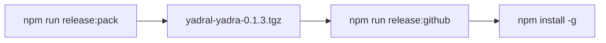

Ce guide décrit le **processus complet** de distribution du CLI Yadra par fichier **`.tgz`** (option 2 : pas de registry npm public).

## Vue d’ensemble



Le fichier **n’est pas versionné dans git** (`yadra/cli/.gitignore` ignore `yadral-yadra-*.tgz` et `vendor/`). Il est publié comme **asset** d’une release GitHub.

---

## 1. Construire le paquet (maintainer)

Depuis le monorepo :

```bash
cd yadra/cli
npm run release:pack
```

(`release:pack` = `npm test` + `verify:vendor` + `npm pack` / `pack:release`)

Résultat : **`yadral-yadra-0.1.3.tgz`** à côté de `package.json`.

| Étape npm | Action |
|-----------|--------|
| **`prepack`** | `YADRA_VENDOR_STRICT=1 node scripts/sync-vendor.mjs` — copie la distribution minimale dans `vendor/yadral-dist/` |
| **`npm pack`** | Archive `src/`, `vendor/`, `scripts/`, `package.json`, `README.md` |

### Contenu copié dans `vendor/yadral-dist/`

| Source (monorepo) | Rôle |
|-------------------|------|
| `yadra/manifest.mf` | Version officielle CLI |
| `yadra/skills/` | SKILLS formalize (T1) + execute (T2 · A) |
| `ksl/grammar/` | Grammaire `ksl.ebnf` |
| `ksl/tools/yadra/lib/` | Moteur validate / seal / plan |
| `prompts/plan-validate/` | Plans T1/T2 validés (yadra-t1, yadra-t2) |

Non inclus : site de documentation, exemples KSL complets, reste du dépôt.

### Vérifications locales

```bash
npm run pack:dry-run          # liste le contenu sans écrire le .tgz
npm run verify:vendor         # sync strict + contrôle des chemins
tar -tzf yadral-yadra-0.1.3.tgz | head
npm test                      # tests CLI + présence vendor
```

### Versionning

Avant chaque release, aligner :

- `yadra/cli/package.json` → `"version"`
- `yadra/manifest.mf` → `version`

Le nom du fichier devient alors `yadral-yadra-<version>.tgz`.

---

## 2. Publier sur GitHub (maintainer)

**Ne pas** `git add` le `.tgz`. Utiliser une **GitHub Release**.

### Interface web

1. Ouvrir le dépôt → **Releases** → **Draft a new release**
2. **Choose a tag** : ex. `yadra-cli-v0.1.3` (créer le tag sur `main` ou le commit voulu)
3. **Release title** : ex. `Yadra CLI 0.1.3`
4. **Attach binaries** : glisser `yadra/cli/yadral-yadra-0.1.3.tgz`
5. **Publish release**

### Prérequis : GitHub CLI (`gh`)

`npm run release:github` appelle `gh release create`. Installez [GitHub CLI](https://cli.github.com/) une fois par machine, puis authentifiez-vous.

**macOS** (Homebrew) :

```bash
brew install gh
gh auth login
```

**Linux — Debian / Ubuntu** :

```bash
sudo apt update
sudo apt install gh
gh auth login
```

**Linux — Fedora / RHEL (dnf)** :

```bash
sudo dnf install gh
gh auth login
```

Autres distributions ou binaires : [installation Linux (officiel)](https://github.com/cli/cli/blob/trunk/docs/install_linux.md).

Vérifier : `gh --version` et `gh auth status`.

### Ligne de commande (npm)

Dépôt : [github.com/yadral/yadra](https://github.com/yadral/yadra)

```bash
git push origin main
cd yadra/cli
npm run release:pack
npm run release:github -- yadra-cli-v0.1.3
```

Sans argument après `--`, le tag par défaut est `yadra-cli-v` + la version lue dans `package.json` (ex. `yadra-cli-v0.1.3` si `"version": "0.1.3"`).

Le script `release:github` joint automatiquement `yadral-yadra-<version>.tgz`, le titre **Yadra CLI &lt;version&gt;** et les notes d’installation (voir **Prérequis : GitHub CLI** ci-dessus — ne pas lancer `gh release create` à la main).

---

## 3. Télécharger et installer (développeur)

Prérequis : **Node.js ≥ 18**.

### Depuis la page Releases

1. **Releases** → choisir la version (ex. `0.1.3`)
2. Télécharger **`yadral-yadra-0.1.3.tgz`**
3. Installer :

```bash
npm install -g ./yadral-yadra-0.1.3.tgz
yadra version
```

Au premier lancement, **`YADRA_PROJECT_HOME`** et **`KSL_HOME`** sont définis depuis la distribution embarquée dans le paquet. **`--yadra-project-home`** n’est pas nécessaire en usage normal.

Configurer le monorepo KSL métier :

```bash
yadra configure set --profile default --provider … --model …
yadra configure credentials --profile default --token …
yadra project add myapp --ksl-project-home /chemin/vers/monorepo-ksl
```

### Lien direct (URL stable par tag)

Remplacer `<org>`, `<repo>` et le nom du tag :

```text
https://github.com/yadral/yadra/releases/download/yadra-cli-v0.1.3/yadral-yadra-0.1.3.tgz
```

```bash
curl -L -o yadral-yadra-0.1.3.tgz \
  "https://github.com/yadral/yadra/releases/download/yadra-cli-v0.1.3/yadral-yadra-0.1.3.tgz"
npm install -g ./yadral-yadra-0.1.3.tgz
```

Dépôt **privé** : authentification GitHub (session navigateur ou token avec accès au repo).

---

## 4. Après installation

| Action | Commande |
|--------|----------|
| Vérifier l’outil | `yadra version` |
| Contexte KSL | `yadra project add myapp --ksl-project-home …` |
| Timeline 1 | `yadra formalize …`, `yadra validate …`, `yadra seal …` |
| Timeline 2 | `yadra plan …` |

Mise à jour : retélécharger le `.tgz` de la nouvelle release, puis :

```bash
npm install -g ./yadral-yadra-<nouvelle-version>.tgz
```

---

## Évolution (option 1)

Le même artefact `.tgz` pourra être publié sur un **registry npm privé** (`npm publish`) sans changer le flux de build (`prepack` + `sync-vendor`). Voir la section installation de la [vue d’ensemble](/docs/overview/).
