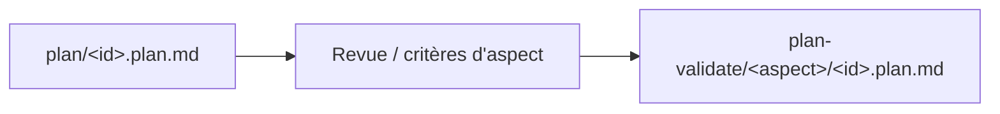

# Mode dépôt — prompts & plans

Espace versionné pour **prompts de travail** et **plans** (Cursor, agents, T1/T2), distinct de **`ksl/`** (langage scellé) et de **`scripts/`** (outils).

| Dossier | Rôle |
|---------|------|
| [`plan/`](plan/) | Plans **en cours** ou **brouillon** — plusieurs plans peuvent coexister |
| [`plan-validate/`](plan-validate/) | Plans **validés** pour un **aspect** donné (copie figée + métadonnées) |

## Cycle de vie

1. Créer un plan sous `plan/` (copier [`plan/_template.plan.md`](plan/_template.plan.md)).
2. Itérer dans `plan/` jusqu’à ce que le plan soit **connecté** (périmètre clair, prêt à coder — ex. dans `ksl/tools/yadra`).
3. **Implémenter** ; si l’impl est **correcte** (critères du plan OK), **promotion** vers `plan-validate/<aspect>/` : copie figée, en-tête `status: validated`, `validated_at`, `aspect`, `source_plan`.
4. Tant que l’impl n’est pas validée, le plan reste dans `plan/` (`status: draft` ou `in_progress`).

Ne pas modifier un fichier sous `plan-validate/` sans nouvelle validation : créer une nouvelle révision dans `plan/` puis re-promouvoir.

## Aspects (exemples)

Nom de sous-dossier = identifiant stable (kebab-case). Exemples alignés Yadra × KSL :

| Aspect | Exemple d’usage |
|--------|------------------|
| `ksl-language` | Évolution grammaire / spec auteur |
| `yadra-t1` | Formalisation, scellement, boucle A–B–C |
| `yadra-t2` | Matérialisation, producteurs, gate |
| `distribution` | Partage KSL, CLI, extension |
| `repo-layout` | Structure du dépôt (`ksl/`, `prompts/`, …) |

Ajouter un dossier sous `plan-validate/` au premier plan validé pour cet aspect.

## Plans Yadra validés et SKILLS

Chaque plan sous [`plan-validate/yadra-t1/`](plan-validate/yadra-t1/) et [`plan-validate/yadra-t2/`](plan-validate/yadra-t2/) qui pilote une phase inclut **§ Exécution du SKILL runtime** (registre, binding CLI, commande, LLM ou non, comportement agent). Brouillons futurs : [`plan/yadra/v1/`](plan/yadra/v1/). Synthèse : [`docs/yadra-ksl-processing.md`](../docs/yadra-ksl-processing.md).

| Plan | Phase | SKILL |
|------|-------|-------|
| [`t1-comprendre-intention`](plan-validate/yadra-t1/t1-comprendre-intention.plan.md) | T1 · A | `formalize/partie-a-comprendre` |
| [`t1-produire-ksl`](plan-validate/yadra-t1/t1-produire-ksl.plan.md) | T1 · B | `formalize/partie-b-produire` |
| [`t1-livrer-ksl`](plan-validate/yadra-t1/t1-livrer-ksl.plan.md) | T1 · C · LIVRER | `formalize/partie-c-livrer` |
| [`t2-livrer-gate`](plan-validate/yadra-t2/t2-livrer-gate.plan.md) | T2 · C · LIVRER | `execute/partie-c-livrer` |
| [`t2-comprendre-contrat`](plan-validate/yadra-t2/t2-comprendre-contrat.plan.md) | T2 · A | `execute/partie-a-comprendre` (+ annexe `strategies/catalog` pour `yadra strategies explain`) |
| [`t2-produire-artefacts`](plan-validate/yadra-t2/t2-produire-artefacts.plan.md) | T2 · B | `execute/partie-b-produire` |

## Relation avec l’KSL

- Les **plans** décrivent *comment* travailler ou *quoi* implémenter ; ils ne remplacent pas un `*.spec.ksl` scellé.
- Contexte produit/langage : [`ksl/CONTEXTE-PROMPT.md`](../ksl/CONTEXTE-PROMPT.md).
- Commande CLI **`yadra plan`** (plan d’exécution T2 depuis une spec) ≠ fichiers de ce dossier ; ici « plan » = document de travail humain/agent.

## Fichiers

Convention : `*.plan.md`, en-tête YAML entre `---` (voir template).
